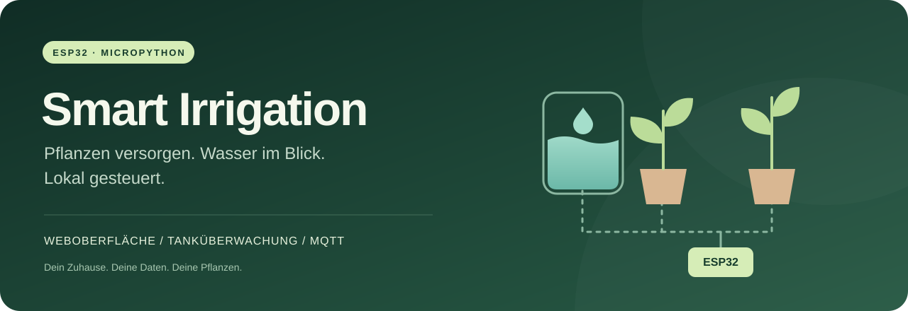
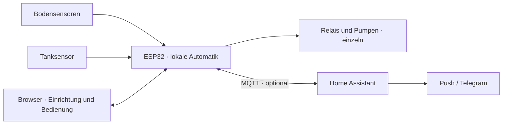

  

  
  
  
  

# ESP32 Smart Irrigation

Deine Pflanzen. Ihr Wasserbedarf. Deine Steuerung.

Eine lokale Bewässerungssteuerung für den ESP32 mit MicroPython: Bodenfeuchtigkeit messen, Wasser in kalibrierten Portionen dosieren und den Tank im Blick behalten. Die Automatik läuft auf dem Gerät. Im Browser richtest du alles ein; Home Assistant ergänzt bei Bedarf Bedienung und Benachrichtigungen über MQTT.

**[Loslegen](docs/GETTING_STARTED.md) · [Verkabelung](rebuild/docs/VERKABELUNG.md) · [Home Assistant](docs/HOME_ASSISTANT_V4.md) · [Release herunterladen](https://github.com/JannWdl/ESP32-SmartIrrigation/releases/latest)**

## Was das Projekt kann

| | Im Alltag |
|---|---|
| **Gezielt gießen** | Kalibrierte Wasserportionen, Einwirkpausen und anpassbare Pflanzenprofile. Zwei Kanäle sind vorbelegt. |
| **Den Tank überwachen** | HC-SR04-Messung mit Drei-Punkt-Kalibrierung, Reservegrenze und optionaler Literanzeige. |
| **Grenzen einhalten** | Eine Pumpe zur Zeit, Laufzeit- und Mengenlimits, Startpause und dauerhafte Stoppsperre bis zur Freigabe. |
| **Lokal bedienen** | Einrichtungsassistent, Übersicht, Verlauf und Einstellungen im Browser; kein Cloud-Konto nötig. |
| **Home Assistant einbinden** | MQTT Discovery für Messwerte, Status, Portionstasten und Automatikschalter. |
| **Schlank bleiben** | Komprimierte Webdateien, Browser-Cache und Abfragen nach Bedarf entlasten den ESP32. |

## So arbeitet die Steuerung

Die Wassermenge wird aus gemessener Fördermenge und Laufzeit geschätzt. Tagesbudgets zählen konservativ 24 Stunden aktive Betriebszeit. Details stehen in der [V4-Dokumentation](rebuild/README.md#wasserbudgets-und-kalibrierung).

## Der passende Einstieg

| Dein Ausgangspunkt | Nächster Schritt |
|---|---|
| Neues Gerät oder Wechsel von V3 | [V4 frisch installieren und kalibrieren](docs/GETTING_STARTED.md#neuinstallation-oder-wechsel-von-v3). Die Einrichtung beginnt mit neuen Einstellungen. |
| V4.0.0 / V4.0.1 läuft bereits | [Einmaliges USB-Anwendungsupdate](docs/GETTING_STARTED.md#bestehende-v400--v401-aktualisieren) mit Erhalt der V4-Einstellungen und Budgets. |
| V4.0.2 oder neuer läuft bereits | Vollständiges Paket aus den [Releases](https://github.com/JannWdl/ESP32-SmartIrrigation/releases/latest) unter „System & Updates“ hochladen. |
| Erst einmal ansehen | [Demo-Datei herunterladen](https://raw.githubusercontent.com/JannWdl/ESP32-SmartIrrigation/main/rebuild/preview.html), als `preview.html` speichern und im Browser öffnen. Sie verwendet Beispieldaten. |

## Hardware

Die Referenzkonfiguration nutzt einen ESP32/WROOM, zwei kapazitive Bodensensoren, zwei 5-V-Pumpen mit Relais und einen gemeinsamen Tank mit HC-SR04. Die [Anschlussanleitung mit Schaltbildern](rebuild/docs/VERKABELUNG.md) beschreibt Versorgung, Pegelwandlung und Erstprüfung.

Vor Installation und Verdrahtung die Pumpenversorgung trennen. Pumpen separat versorgen; das 5-V-Echosignal des HC-SR04 benötigt eine Pegelwandlung zum ESP32. Pins und Relaispolarität am tatsächlichen Aufbau prüfen, bevor Ausgänge freigegeben werden.

## Projektstand

**Aktuell: V4.0.2.** Python- und Browser-Prüfungen sowie die Offline-Simulation wurden erfolgreich ausgeführt. Web- und Netzwerkoptimierungen wurden mit der zugrunde liegenden V4.0.1 auf einem ESP32 geprüft. Das vollständige V4.0.2-Paket und der USB-Migrationsweg wurden noch nicht erneut auf Hardware durchlaufen. [Release Notes und Updatehinweise](RELEASE_NOTES.md)

## Im Repository

| Pfad | Inhalt |
|---|---|
| [`rebuild/`](rebuild/README.md) | Aktuelle V4: Firmware, Weboberfläche, Werkzeuge und Tests. |
| [`docs/`](docs/README.md) | Einstieg, Home Assistant und Dokumentationsübersicht. |
| [`aktuell/`](aktuell/) | Erhaltene V3-Firmware und zugehörige HA-Beispiele. |
| [`docs/legacy/`](docs/legacy/README.md) | Anleitungen und Release Notes für V3. |
| [`home_assistant_hacs_repo_template/`](home_assistant_hacs_repo_template/) | Historische V3-Integrationsvorlage; für V4 genügt MQTT Discovery. |

## Mitmachen

Fehler oder Ideen? [Ein Issue öffnen](https://github.com/JannWdl/ESP32-SmartIrrigation/issues/new/choose). Für Änderungen an Firmware und Oberfläche gibt es eine [Entwicklungsanleitung](CONTRIBUTING.md). Das Projekt steht unter der [MIT-Lizenz](LICENSE).
